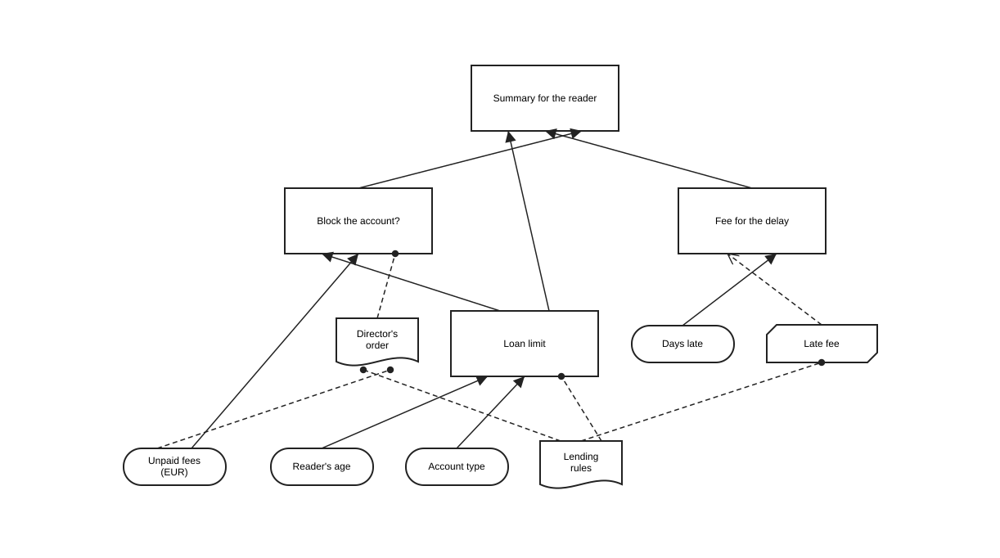

# Decisions with DMN and FEEL {#decisions}

::: {.goals}
**In this chapter** you will write decision tables with inputs, outputs, hit policies, aggregations, allowed values and default outputs · build decision requirements graphs from decisions, input data, knowledge sources and business knowledge models · express decision logic as literal expressions, contexts, lists, relations, invocations and functions · declare DMN types · write FEEL at conformance level 3, including names with spaces, dates and durations · test decisions with `tok eval` · call a decision from a process with a business rule task · export and import DMN files, and read the DMN TCK results as evidence of conformance
:::

Many steps of an information process are decisions taken by rules: how many books a reader may borrow, whether a request needs the head of department's approval, how much a late return costs, in which mode a file may be made available. When such rules are hidden in a task called "Decide on the request", the process model says that a decision is taken but not how. **DMN** (Decision Model and Notation), the companion standard of BPMN, describes the decision itself: its inputs, its rules, and the other decisions and sources of knowledge it depends on.

tok writes decisions in the same text as processes. A document of language 1.0 describes complete DMN 1.5 decision models, evaluates them with `tok eval`, exports them as DMN files with diagrams, and imports DMN files written by other tools. All expressions are written in **FEEL**, the expression language of DMN.

## A first decision table

The loan limit of a university library depends on the age of the reader and the type of the account:

```{r decisions-limit-code, results='asis'}
tok_code("09-loan-limit")
```

`r download_tok("09-loan-limit")`

The document has three statements. The two `inputdata` lines declare the **input data** of the decision: the information that comes from outside, with a FEEL type. The `decision` line declares the decision, says with `requires=` which elements it depends on, and chooses the hit policy. Its block is a **decision table**:

- The first row is the **header**. The cells before `||` are the **inputs**, the cells after it the **outputs**; each cell is `name: type`. An input is a FEEL expression, usually just the name of input data; an output is the name of the result.
- Every further row is a **rule**. Its input cells are **unary tests** applied to the input values: `< 18`, `>= 18`, `"staff"`, a list of values `"student", "doctoral"`, or `-` for any value. Its output cells are FEEL expressions that give the result.
- An optional last column, after a second `||`, is the **annotation** of each rule: a short explanation for the reader, exported as a rule annotation.

The types of the header are FEEL types: `string`, `number`, `boolean`, `date`, `time`, `date and time`, `days and time duration`, `years and months duration`, `list`, `context`, `any`, or a DMN type of the document (see [Types](#dmn-types)).

### Testing with `tok eval`

A decision table is a small program, and it should be tested like one. `tok eval FILE DECISION name=value …` evaluates a decision for given input values and prints its result as JSON:

```
tok eval 09-loan-limit.tok limit age=20 account=student
15
tok eval 09-loan-limit.tok limit age=16 account=staff
5
tok eval 09-loan-limit.tok limit age=40 account=guest
10
```

The decision is named by its identifier. Each argument is `name=value`, where `name` is the FEEL name of input data. A value is read as `true` or `false`, as a number, as JSON when it is a JSON object or list (`copies='[{"year": 1932}]'`), and otherwise as text. Text given to input data of a date or time type is read as that type (`due=2027-03-01`). Input data that is not given is `null`. Put an argument in quotes when the name or the value contains spaces: `"Unpaid fees=80"`.

The exit code is 0 for a result, 1 when the document has errors or a hit policy is violated (below), and 2 for an unknown decision or an argument that is not `name=value`.

::: {.tip}
A decision sees exactly what it **requires**, nothing else. If the table above did not declare `age` and `account` as input data and require them, the names in its header would refer to nothing, both inputs would be `null`, and every evaluation would fall through to the last rule: `tok eval` would print `10` for every reader. Declare the inputs of every decision as `inputdata` and list them in `requires=`. When a decision uses a name of the document without requiring it, `tok check` reports the warning `R079`.
:::

## Hit policies

When several rules of a table match, the **hit policy** decides what the result is. It is set with `hit=`:

| `hit=` | Matching rules | Result |
|---|---|---|
| `unique` (default) | at most one rule may match | the output of that rule; several matching rules violate the policy |
| `first` | any number | the output of the first matching rule, in the order of the table |
| `any` | any number, all with the same output | that output; different outputs violate the policy |
| `priority` | any number | the output that comes first in the list of **output values** |
| `collect` | any number | a list of the outputs of all matching rules; with `aggregation=` their sum, count, minimum or maximum |
| `rule-order` | any number | a list of the outputs of all matching rules, in the order of the rules |
| `output-order` | any number | a list of the outputs of all matching rules, ordered by the output values |

The following document about overdue books shows the less common policies.

```{r decisions-hit-code, results='asis'}
tok_code("09-hit-policies")
```

`r download_tok("09-hit-policies")`

A few features of tables appear here for the first time:

- **Input expressions.** An input need not be a plain name. `returned - due` subtracts two dates and gives a duration; `(returned - due).days` takes its number of days; `returned > due` is a boolean.
- **Input values and output values.** A header cell may list the allowed values after `=`: `value: number = [0..10000]`, `urgency: string = "urgent", "normal", "none"`. For an output, the order of these values is the **priority** used by `priority` and `output-order`. These two policies need output values for at least one output (`D006`).
- **Aggregation.** `aggregation=sum` (or `count`, `min`, `max`) applies to `hit=collect` with one output (`D007`).
- **Default output.** `default="0"` gives the result when no rule matches; for several outputs, `default="channel = \"letter\"; cost = 0.8"`. Without a default, no matching rule gives `null` (an empty list for `collect`, `rule-order` and `output-order`, and `0` for `aggregation=count`).
- **Several outputs.** With two outputs, each result is a context with both: `{"channel": "SMS", "cost": 0.1}`.

For a student who returned a book worth 250 EUR nineteen days late:

```
tok eval 09-hit-policies.tok fee-band due=2027-03-01 returned=2027-03-20 value=250 account=student
"reduced"
tok eval 09-hit-policies.tok urgency due=2027-03-01 returned=2027-03-20 value=250 account=student
"urgent"
tok eval 09-hit-policies.tok points due=2027-03-01 returned=2027-03-20 value=250 account=student
3
tok eval 09-hit-policies.tok notices due=2027-03-01 returned=2027-03-20 value=250 account=student
[{"channel": "e-mail", "text": "Your loan is overdue."}, {"channel": "SMS", "text": "Please return the book."}]
tok eval 09-hit-policies.tok channels account=student
[{"channel": "SMS", "cost": 0.1}, {"channel": "e-mail", "cost": 0}]
```

The urgency is "urgent" because two rules match (`> duration("P0D")` with `> 200`, and `> duration("P0D")` alone) and "urgent" comes before "normal" in the output values. The points add up the first two rules, 1 + 2. The channels are ordered by the output values, so the SMS comes first although its rule is second. When nothing matches, the defaults apply:

```
tok eval 09-hit-policies.tok points due=2027-03-01 returned=2027-02-20 value=100
0
tok eval 09-hit-policies.tok channels account=guest
[{"channel": "letter", "cost": 0.8}]
```

### Overlapping rules

Under `unique`, two rules that can match the same input are a mistake in the table. `tok check` looks for them and reports the warning `D010` with an example input:

```{r decisions-bands-code, results='asis'}
tok_code("09-age-bands")
```

```
tok check 09-age-bands.tok
09-age-bands.tok:8: warning D010: rules 1 and 2 can both match age=17 (hit policy unique)
09-age-bands.tok: 0 error(s), 1 warning(s), 0 note(s)
```

The analysis covers cells built from literals, comparisons and intervals. `tok eval` reports a violation when it happens, with exit code 1:

```
tok eval 09-age-bands.tok band age=16
tok: decision 'band': rules 1, 2 all match (hit policy unique)
tok eval 09-age-bands.tok band age=21
"student"
```

For a 21-year-old only the second rule matches, so the result is correct, but the table is wrong for every minor. Either make the rules exclusive (`[18..26]`) or choose `hit=first` and order the rules deliberately. A violated `any` policy (several matching rules with different outputs) is reported the same way.

## Decision requirements graphs

A real decision rarely stands alone. Whether to block a reader's account depends on the loan limit, which depends on the reader's age and account; the fee for a late return depends on a tariff, which is fixed by the lending rules. DMN draws these dependencies as a **decision requirements graph** (DRG), and its picture as a decision requirements diagram (DRD). It has four kinds of elements:

| tok | DMN element | Shape | Meaning |
|---|---|---|---|
| `inputdata ID "Label"` | input data | oval | information from outside the decision model |
| `decision ID "Label"` | decision | rectangle | a question answered by decision logic |
| `bkm ID "Label"` | business knowledge model | rectangle with cut corners | reusable logic: a function called by decisions |
| `source ID "Label"` | knowledge source | document shape | the authority behind a decision: a regulation, an order, an expert |

`requires="ID …"` on a decision, a business knowledge model or a knowledge source lists what it depends on. The kind of each required element gives the kind of requirement: decisions and input data are **information** requirements (solid arrows), business knowledge models **knowledge** requirements (dashed arrows), knowledge sources **authority** requirements (dashed lines with a dot). A decision may require decisions, input data, business knowledge models and knowledge sources; a business knowledge model may require business knowledge models and knowledge sources; a knowledge source may require decisions, input data and knowledge sources. Other combinations are `R003`, and a cycle of requirements is `R076`.

```{r decisions-drg-code, results='asis'}
tok_code("09-library-drg")
```

`r download_tok("09-library-drg")`

```{r decisions-drg-diagram, fig.cap="The decision requirements diagram of the lending decisions, as tok export draws it."}

```

The graph has four input data, two knowledge sources, one business knowledge model and four decisions:

- `limit` is the decision table of the previous sections, now with the authority of the lending rules, a `question=` and the allowed `answers=` that DMN records for a decision.
- `blocked` is a **literal expression**: `expr="Unpaid fees > 50 or limit < 1"`. Its FEEL name is given with `name="Account blocked"`, a name with a space.
- `fee` is an **invocation** of the business knowledge model `late-fee`: `invoke=late-fee with="days = days-late; rate = 0.5"` binds each parameter of the model to a FEEL expression.
- `summary` combines three decisions into a sentence for the reader.

Each element has a **FEEL name**: its identifier, or the value of `name=` when the name is not a tok identifier (`name="Unpaid fees"`). Other elements refer to it by that name. The names of a graph are unique (`R080`). The label is what the diagram shows.

Evaluating a decision evaluates everything it requires, each required decision once:

```
tok eval 09-library-drg.tok summary age=22 account=student "Unpaid fees=12" days-late=9
"limit 15, fee 4.5 EUR"
tok eval 09-library-drg.tok summary age=22 account=student "Unpaid fees=80" days-late=9
"account blocked"
tok eval 09-library-drg.tok fee days-late=9
4.5
```

A knowledge source has no logic; it documents who stands behind a decision, with an optional `kind=` and `uri=`. A decision without any logic is allowed too: it describes a decision that is taken by a person, and its value is `null`.

## Boxed expressions

The logic of a decision or a business knowledge model is a **boxed expression**. Tables and literal expressions are the most common; DMN 1.5 has more, and tok writes each of them as one line or a block:

| tok | DMN boxed expression |
|---|---|
| `expr="FEEL"` | literal expression |
| a block of rows with `\|\|` | decision table |
| a block of rows without `\|\|`: a header `name: type`, then rows of FEEL expressions | relation (a list of contexts, like a small table of data) |
| a block of `entry NAME …` lines, optionally ending with a `result …` line | context: named entries computed in order; its value is the result line, or without one the context of all entries |
| a block of `element …` lines | list |
| `invoke=BKM with="param = FEEL; …"` | invocation of a business knowledge model |
| `params="name: type, …"` on an `entry`, `result` or `element` line | function definition, whose body is the logic of the line |

Each line of a context or list has its own logic, which may be a literal expression, an invocation, or a block of its own indented below it (a table, a relation, a nested context or list).

```{r decisions-boxed-code, results='asis'}
tok_code("09-boxed")
```

`r download_tok("09-boxed")`

The decision `fee` is a context with five lines. `rates` is a **relation**: a table of data with one row per kind of item. `rate` filters the relation with FEEL (`rates[type = kind].rate[1]`: the rate of the row whose type is the kind of the item). `round2` is a **function definition**, local to the context. `charged` **invokes** the business knowledge model `charge`, whose own logic is a context with a result. The `result` line gives the value of the decision.

`account-types` is a **list**. `overview` is a context without a result: its value is the context of all entries, and one entry, `inspection`, is a decision table nested in the context. An entry name may be quoted when it has spaces (`entry "to repair"`).

```
tok eval 09-boxed.tok fee kind=journal days=12
2.4
tok eval 09-boxed.tok fee kind=book days=400
100
tok eval 09-boxed.tok account-types
["student", "doctoral", "staff"]
tok eval 09-boxed.tok overview copies='[{"shelfmark": "A-12", "year": 1932, "condition": "damaged"}, {"shelfmark": "B-7", "year": 1988, "condition": "good"}]'
{"count": 2, "oldest": 1932, "to repair": ["A-12"], "inspection": true}
```

The second result shows the cap of the business knowledge model: 400 days at 0.5 EUR would be 200, and `min([amount, 100])` limits it to 100.

A statement has exactly one form of logic; `with=` needs `invoke=`; the `result` line is the last line of its context; `element` lines are not mixed with `entry` and `result` lines. A violation of any of these is `R077`. `hit=`, `aggregation=` and `default=` need a decision table.

## Types {#dmn-types}

The inputs and outputs of a decision have **types**. Simple ones are FEEL types (`number`, `string`, `date`, …, and type expressions such as `list<number>`). Structured ones are **DMN types**, declared with `item`:

```tok
item copy-t "Copy"
  item shelfmark type=string
  item year type=number
  item condition type=string allowed="\"good\", \"damaged\""
item copies-t "List of copies" collection type=copy-t
```

| tok | DMN `itemDefinition` |
|---|---|
| `type=T` | the base type |
| `allowed="unary tests"` | the allowed values |
| `collection` | a list of such values |
| a block of `item NAME …` lines | the components of a structure (nested to any depth) |

`type=` on input data, decisions, business knowledge models, lines of boxed expressions and parameters names a FEEL type or a DMN type of the document, by identifier or by name; an unknown type is `R081`. A value that does not conform to its type becomes `null`, as DMN 1.5 prescribes. DMN types are exported to the DMN files, not to BPMN; an `item` that is both a BPMN item definition (`structure=`, `kind=`; Chapter \@ref(data-artifacts)) and a DMN type is `R081`.

## FEEL in tok

FEEL (Friendly Enough Expression Language) is the expression language of DMN. In tok it is used everywhere an expression is needed: in decision logic, and in the processes in conditions of flows (`when=`), conditional events (`condition=`), script tasks (`expr=`), loop conditions and the attributes of the executable layer.

In a document of language 1.0 every expression is **full FEEL at DMN conformance level 3**:

| Feature | Example |
|---|---|
| numbers with 34 significant digits, exact decimal arithmetic | `0.1 + 0.2 = 0.3` is `true` |
| strings, booleans, `null` and three-valued logic | `"Nr " + string(n)`, `a and b` |
| dates, times, durations and their arithmetic | `date("2027-03-01") + duration("P30D")`, `@"2027-07-01"` |
| lists, filters and paths | `copies[condition = "damaged"].shelfmark`, `l[1]`, `l[-1]` |
| contexts | `{kind: "book", rate: 0.5}.rate` |
| ranges and unary tests | `x in [1..10]`, `x between 18 and 65` |
| iteration and quantifiers | `for i in 1..3 return i * 7`, `some x in l satisfies x > 1` |
| functions | `function(x) x * 2`, the built-in library (`string length`, `round half up`, `day of week`, `list contains`, `sort`, `context put`, …) |
| types | `x instance of list<number>` |

Two rules are specific to tok. Expressions are written **without** the leading `=` that Camunda uses in its files; the exporter adds it where it is needed. And because expressions stand inside quoted attribute values, a quotation mark inside FEEL is written `\"`: `expr="if Account blocked then \"blocked\" else \"open\""`.

### Names with spaces

FEEL allows names with spaces and with the symbols `. / - ' + *`, such as `Loan date` or `days-late`. A name is resolved against the names of the document: the longest sequence of words that is a name of the decision model (an element, an entry, a parameter, a component of a type, a column) or of a built-in function is read as one name. A tok identifier cannot contain spaces, so an element with such a name gets it with `name=`:

```{r decisions-dates-code, results='asis'}
tok_code("09-due-dates")
```

`r download_tok("09-due-dates")`

```
tok eval 09-due-dates.tok due "Loan date=2027-07-20" "Loan period=30"
"2027-08-19"
tok eval 09-due-dates.tok weekend "Loan date=2027-07-20" "Loan period=30"
false
tok eval 09-due-dates.tok on-closed-day "Loan date=2027-07-20" "Loan period=30" closed='["2027-08-19", "2027-12-24"]'
true
tok eval 09-due-dates.tok reminders "Loan date=2027-07-20" "Loan period=30"
["2027-08-26", "2027-09-02", "2027-09-09"]
tok eval 09-due-dates.tok summer "Loan date=2027-07-20"
true
```

Dates, times and durations are printed as their FEEL text. An input that does not conform to its type is `null`, and so is everything computed from it:

```
tok eval 09-due-dates.tok due "Loan date=2027-07-20" "Loan period=thirty"
null
```

FEEL as Camunda 8 runs it differs in one visible point: it reads a name with spaces or symbols only in backticks (`` `Loan date` ``). When a document is executable for Camunda (Chapter \@ref(executable)), `tok export` writes such names in backticks in the DMN files; other documents are exported in standard FEEL.

Documents of languages 0.1 to 0.6 use a smaller subset of FEEL (without contexts, filters, iteration, temporal arithmetic and names with spaces), in which an expression outside the subset is the warning `F001`. In a 1.0 document `F001` reports only what tok does not evaluate, externally defined functions. A syntax error is always the error `F002`.

## Decisions in a process

A process calls a decision with a **business rule task**:

```tok
rule mode "Determine the approval mode" decision=approval-mode result=mode
```

`decision=` names the decision; `result=` names the variable that receives its value. Without `result=`, the variable is the only output of a decision table, or else the FEEL name of the decision. The variables of the process instance are the input data of the decision: here the proposal's `format` and `price`. The following flows use the result in their conditions.

```{r decisions-process-code, results='asis'}
tok_code("09-purchase-approval")
```

```{r decisions-process-diagram, fig.cap="A business rule task that calls the decision approval-mode; the conditions of the following gateway use its result."}
diagram("09-purchase-approval")
```

`r download_tok("09-purchase-approval")` `r download_bpmn("09-purchase-approval")`

```
tok eval 09-purchase-approval.tok approval-mode format=print price=99
"automatic"
```

The BPMN standard has no attribute that links a business rule task to a DMN decision. tok keeps the link in the text, checks it (`decision=` must name a decision of the document), uses it when it simulates the process (Chapter \@ref(simulation)), and in an executable document exports it as Camunda's `zeebe:calledDecision`, so that the engine evaluates the decision when the task is reached (Chapter \@ref(executable)).

Camunda 8 executes decision tables, literal expressions, contexts, relations, lists, invocations and business knowledge models. In an executable document `tok check` reports what it does not run: a business knowledge model whose logic is an invocation (`C130`), a function definition whose body is not a literal expression (`C131`), and a decision without logic (`C132`).

## DMN export

`tok export` writes one DMN 1.5 file for each connected decision requirements graph of the document, named after its first decision, together with a picture of its diagram:

```
tok export 09-library-drg.tok -o out
out\limit.dmn
out\limit.drd.svg
```

The DMN file contains the input data, knowledge sources, business knowledge models, decisions, requirements and DMN types of the graph, and a DMNDI diagram laid out automatically, with decisions above what they require. It opens in Camunda Modeler and in the DMN editor of bpmn.io. A document whose decisions are not connected writes one file per graph: `09-boxed.tok` gives `fee.dmn`, `account-types.dmn` and `overview.dmn`.

## DMN import

`tok import FILE.dmn` reads a DMN file of version 1.1 to 1.5 and prints a document of language 0.7, which is also a valid document of every release 1.x. It keeps the decisions, input data, knowledge sources, business knowledge models, requirements, decision logic, types, names and descriptions, and reports what it does not keep. The file `09-special-collections.dmn` contains a table of the modes in which special collections are made available (<a class="download" href="examples/09-special-collections.dmn" download>Download the DMN file (.dmn)</a>):

```
tok import 09-special-collections.dmn
09-special-collections.dmn: TextAnnotation_0rule: textAnnotation is not kept
09-special-collections.dmn: -: the diagram (DMNDI) is not kept; tok lays out the decision requirements diagram again
tok 0.7 "Access to special collections"

decision Decision_0access name="Access mode" hit=first
  | materialAge: number | personalData: boolean | purpose: string = "research","official","private" || mode: string = "reading room","anonymised copy","director's consent","refused" ||                                        |
  | >= 100              | -                     | -                                                 || "reading room"                                                                 || Old material: no restrictions          |
  | -                   | false                 | -                                                 || "reading room"                                                                 || No personal data                       |
  | -                   | true                  | "research"                                        || "anonymised copy"                                                              || Research: a copy without personal data |
  | < 30                | true                  | "private"                                         || "refused"                                                                      || Private purpose, recent material       |
  | -                   | -                     | -                                                 || "director's consent"                                                           || Everything else                        |
```

The table keeps its hit policy, its input and output values and the descriptions of its rules, which become annotations. The identifiers of the file are kept, and the name of the decision, "Access mode", is given with `name=`. The text annotation and the diagram are reported.

This table was written for a process engine: its inputs `materialAge`, `personalData` and `purpose` are variables of the process, not input data of a decision model. Camunda evaluates it with the variables of the process instance. To evaluate it with `tok eval`, save the import with `-o`, declare the three variables as input data and require them, as the tip earlier in this chapter explains. With the header changed to `tok 1.0` and the document formatted, the model reads:

```{r decisions-import-code, results='asis'}
tok_code("09-special-collections")
```

`r download_tok("09-special-collections")`

```
tok eval 09-special-collections.tok Decision_0access materialAge=20 personalData=true purpose=private
"refused"
tok eval 09-special-collections.tok Decision_0access materialAge=45 personalData=true purpose=research
"anonymised copy"
```

Decision services, imports of other models, text annotations, associations and groups, organisation units, performance indicators and the diagram are not kept, and the import names each of them. The DMN files that tok exports import back to the same document, apart from comments and the order of `requires=`.

## The DMN TCK as evidence

How do you know that `tok eval` computes what DMN says? The **DMN Technology Compatibility Kit** (TCK) is a public collection of DMN models with test cases and expected results, maintained by vendors and users of DMN to measure the conformance of implementations. Its tests are grouped by the compliance levels of DMN: level 2 covers decision tables and simple expressions, level 3 the full language with FEEL, boxed expressions and decision requirements graphs.

tok runs every model of levels 2 and 3 that does not need a feature outside its scope: each model is imported, printed as tok text, read again and evaluated for every test case, and each result is compared with the expected value.

| Level | Models | Models passing completely | Results | Passing |
|---|---|---|---|---|
| 2 | 28 | 28 | 126 | 126 (100.0 %) |
| 3 | 114 | 108 | 3331 | 3313 (99.5 %) |

The test folders left out need what tok does not implement: functions defined externally in Java, decision services, and models that import other models. The 18 results of level 3 that fail have known reasons: dates in time zones whose offset depends on the date (such as Europe/Paris), which would need the IANA time zone database; a unary test of one value used as a range value; two tests that invoke decision services; and a boxed filter whose elements are not booleans. Appendix \@ref(conformance) gives the full table.

These numbers are the evidence behind the claim that a decision tested with `tok eval` behaves as DMN 1.5 specifies, and behind the import: each TCK model passes through `tok import`, so the import keeps everything a decision needs to be evaluated.

## Typical mistakes

The following decision model computes the fee for interlibrary loan copies. It contains mistakes on several layers.

```{r decisions-error-code, results='asis'}
tok_code("09-decisions-error")
```

```
tok check 09-decisions-error.tok
09-decisions-error.tok:13: error D002: rule has 3 cells, the header has 2
09-decisions-error.tok: 1 error(s), 0 warning(s), 0 note(s)
```

A malformed table hides the rest of the model, as malformed text does in Chapter \@ref(checking). After the row is corrected to `| "e-mail" || 0 |`, the check reports:

```
tok check 09-decisions-error.tok
09-decisions-error.tok:8: warning R079: 'copy-fee' uses 'pages' (inputdata 'pages') without requiring it; add it to requires=
09-decisions-error.tok:8: warning R079: 'copy-fee' uses 'per-page' (bkm 'per-page') without requiring it; add it to requires=
09-decisions-error.tok:15: error F002: FEEL syntax error: unexpected end of expression (copy-fee + postage +)
09-decisions-error.tok:15: error R081: unknown type 'numbr' (a FEEL type or an item of the document)
09-decisions-error.tok:18: error D006: hit policy priority orders the matching rules by output values; give them for at least one output (name: type = …)
09-decisions-error.tok: 3 error(s), 2 warning(s), 0 note(s)
```

| Code | Problem | Correction |
|---|---|---|
| `D002` | a rule with more cells than the header | one cell per column |
| `R079` | a decision uses input data and a business knowledge model it does not require | `requires="pages per-page"` |
| `F002` | an incomplete FEEL expression | `expr="copy-fee + postage"` |
| `R081` | a misspelt type | `type=number` |
| `D006` | `priority` without output values | `band: string = "high", "low"`, or `hit=first` |

## Exercises {-}

::: {.exercise}
1. **Repair the fees.** Download `09-decisions-error.tok` and correct it until `tok check` reports no errors and no warnings. Then evaluate `total` and `band` for 120 pages sent by post. `r download_tok("09-decisions-error", "Download the model with errors (.tok)")`
2. **A table from a regulation.** Take a short regulation of your institution (opening hours, loan periods, fees) and write its rules as a decision table with input data and annotations that cite the paragraphs. Test at least five cases with `tok eval`, including a boundary value of each comparison.
3. **Hit policies.** Write the age bands of `09-age-bands.tok` three times: with `unique` and exclusive rules, with `first`, and with `priority` and output values. Show with `tok eval` that the three versions give the same results for the ages 17, 18, 26 and 27.
4. **A decision requirements graph.** Model the decision whether a reader may borrow a rare book: it depends on the type of account, on unpaid fees and on a separate decision "Is the reader trusted?", which depends on the number of past loans. Add the reading room regulation as a knowledge source. Export the graph with `tok export` and open the DMN file in Camunda Modeler.
5. **Boxed expressions.** Extend `09-boxed.tok` with a decision that returns, for a list of copies, a list of contexts with the shelfmark and the age of each copy in years (use `for` and a context). Test it with a JSON list of three copies.
6. **From a process.** Add a business rule task to a process of your own that calls one of your decisions, with `result=` and a gateway that uses the result. Check the model, export it and find the decision in the files `tok export` writes.
:::
